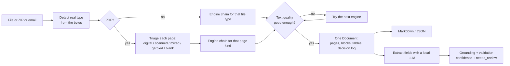

# DoctorDoc

**One door for any document: it works out what the file is, picks the best engine for each page, and returns clean Markdown/JSON plus fields you can trace back to the source text.**

> Status: early (v0.1). Parsing + router, field extraction, a web UI and a synthetic benchmark work.
> The API and the Docker image are not built yet. Apache-2.0, fully local by default.

## Quickstart

```bash
git clone <this repo> && cd doctordoc
uv venv && source .venv/bin/activate
uv pip install -e ".[ocr,docling,markitdown]"   # extras are optional: see `doctordoc engines`

doctordoc parse report.pdf --explain            # Markdown + the router's decision log
doctordoc triage report.pdf                     # what kind is each page?
doctordoc engines                               # which engines are installed, and their licenses
doctordoc ui                                    # web page: upload files, try the samples in examples/

ollama pull llama3.2:3b                         # for field extraction (local model, a large download)
doctordoc extract invoice.pdf --schema invoice
```

```python
from doctordoc import parse
from doctordoc.extract import extract

doc = parse("scan.pdf")
print(doc.to_markdown())
result = extract(doc, "invoice")  # or your own Pydantic model
print(result.needs_review)  # fields a human should check
print(result.field("total").source)  # page + exact text span it came from
```

## How it works



## Web UI (`doctordoc ui`)

```bash
uv pip install -e ".[ui]"        # Streamlit
doctordoc ui                     # opens http://localhost:8501; pass --config my.yaml to change settings
```

Pure Python (Streamlit), no JavaScript build. Upload one or many files, or a ZIP; every file is
written to a temporary folder, parsed, and deleted: nothing is stored. Four tabs:

- **Parse**: detected type (and a warning if the extension lies), one chip per page (digital,
  scanned, mixed, garbled, blank) with page navigation, the page picture next to the extracted
  blocks (real tables), a tree of the files inside a ZIP or email, and the **Output** panel
  (rendered Markdown, raw Markdown, JSON, tables; copy and download; one ZIP of everything for batches).
- **Router log**: why each engine was used, rejected, skipped or failed, with quality and seconds.
- **Extract**: pick a schema (invoice, receipt, drilling report, generic form); every field with
  confidence, grounded or not, and page; click **Source** to see the exact text it came from.
- **Compare engines**: runs each installed engine alone on the same file and shows them side by
  side, with time and text-quality score, and marks the engine the router chose.

The sidebar has the OCR engine (Auto, or force one), **Local only (private)** (on by default; turning
it off allows the cloud fallback and shows a warning that pages would leave your machine), the
local Ollama model, the mixed-page merge switch and an on/off list of engines. To host a small public
demo see [docs/deploy-demo.md](docs/deploy-demo.md). The look is from
[docs/design/mockup.png](docs/design/mockup.png), a design mockup (made-up data, not a screenshot).

## Extraction output format

`doctordoc extract FILE --format json` prints this, the Extract tab downloads the same thing, and
the future API will return it. One entry per field, then the review list and the problems:

```json
{
  "schema": "Invoice",
  "model": "llama3.2:3b",
  "fields": [
    {"field": "invoice_number", "value": "RI-2025-1047", "confidence": 1.0,
     "grounded": true, "page": 1, "source_text": "RI-2025-1047"},
    {"field": "currency", "value": "USD", "confidence": 0.25,
     "grounded": false, "page": null, "source_text": null},
    {"field": "total", "value": 40000.0, "confidence": 0.95,
     "grounded": true, "page": 1, "source_text": "40,000.00"}
  ],
  "needs_review": ["currency"],
  "validation_issues": [],
  "error": null
}
```

This example (shortened to three fields) was seen during development on `examples/invoice_digital.pdf` with
`llama3.2:3b`. No result file was saved, so read the values, including the confidence scores, as an illustration of the
format, not as measured results.
Note `currency`: the model said `USD`, but the invoice never states a currency, so it is not
grounded, its confidence is low, and it is on the review list. A validation issue looks like
`{"field": "total", "rule": "required", "message": "'total' is required but empty", "severity": "error"}`.

`field` is a path (`line_items[0].amount` for list items). `grounded: false` means the value is
not in the document text (the model made it up): `page` and `source_text` are then `null`.
`validation_issues[].severity` is `error` or `warning`. `error` is `null` unless extraction failed.

## How the router decides

1. **Detect** the real type from the bytes. A `.pdf` that is really a DOCX is handled as a DOCX, with a warning.
2. **Triage** every PDF page: *digital* (good text layer), *scanned* (no text layer), *mixed* (text plus large pictures), *garbled* (text layer exists but is nonsense), *blank*.
3. Each kind has an **engine chain**, which you can edit in `doctordoc.yaml`. The defaults:

   | Page or file kind | Chain (first engine is tried first) |
   |---|---|
   | digital PDF page | `docling` -> `pdf_text` |
   | mixed PDF page | `docling` -> `pdf_text`, plus OCR; the better result is kept and text that only the other engine found is merged in (`merge_mixed_pages`) |
   | scanned PDF page / image | `paddle_vl` -> `rapidocr` -> `tesseract` -> `cloud_vlm` |
   | garbled PDF page | OCR chain first, `pdf_text` last |
   | DOCX / PPTX | `docling` -> `native` -> `markitdown` |
   | HTML | `native` -> `docling` -> `markitdown` |
   | XLSX, CSV, JSON, XML, TXT, MD | `native` -> `markitdown` |
   | email (.eml) | `native` (attachments are parsed again as their own files) |

4. An engine's output is **accepted only if its text quality score passes** (`quality_threshold`, default 0.55). Otherwise the next engine in the chain is tried.
5. Every attempt is written to a **decision log** (`--explain`): which engine, accepted or rejected, why, the quality score, the seconds. A missing engine is skipped and logged, never a crash.
6. RapidOCR and Tesseract first find **which way up** a page is. A page that already reads well (score 0.75 or more,
   `rotation_early_stop`) is read once; otherwise it is read at 0, 90, 180 and 270 degrees and the best angle is kept.
7. Only one heavy model is kept in memory at a time, and it is released after each file.
8. Cloud fallback (`cloud_vlm`) is **off by default**. If you switch it on, page images are sent to the server you configure.

## Engines and licenses

The default engines are all MIT / Apache / BSD, so you can use them commercially.

| Engine | Used for | License | Default? |
|---|---|---|---|
| native (python-docx, openpyxl, python-pptx, stdlib) | DOCX, XLSX, PPTX, CSV, JSON, HTML, email | MIT / BSD / PSF | yes |
| pdf_text (pypdfium2 / PDFium) | digital PDF text, page rendering | Apache-2.0 / BSD-3 | yes |
| [Docling](https://github.com/docling-project/docling) | digital PDF layout and tables, Office files | MIT | yes (extra `docling`) |
| [MarkItDown](https://github.com/microsoft/markitdown) | fallback for Office files | MIT | yes (extra `markitdown`) |
| [RapidOCR](https://github.com/RapidAI/RapidOCR) | scanned pages | Apache-2.0 | yes (extra `ocr`) |
| Tesseract | scanned pages, last local fallback | Apache-2.0 | yes (needs the system package) |
| PaddleOCR-VL | scanned pages (best quality, in theory) | Apache-2.0 | **experimental**: did not fit on our CPU-only test machine (seen during development, no result file saved) |
| cloud_vlm | optional cloud fallback you configure | depends on the service | off |
| Marker | optional plugin, **not written yet** | code GPL-3.0; model weights have revenue/funding limits for commercial use | no |
| MinerU | optional plugin, **not written yet** | custom license with conditions (check it before commercial use) | no |

PyMuPDF is **deliberately not used**: it is AGPL, which would force every user of DoctorDoc to open-source their own code.
Marker and MinerU will only ever be optional plugins that you install yourself, after reading their licenses. Check the current terms of any engine before you ship it in a product.

## Benchmarks

Everything here is measured on **small sets of synthetic files made by this project**. Read the numbers as "does it
work as designed", not as accuracy on your documents.

### Router against single engines

These tables are from the full run on the first 36 files, **before** rotation correction was added.

36 synthetic files (made-up companies, wells and numbers; fixed seed; ground truth for every file), CPU only,
every installed engine run **alone** and then the **router**. Text = 1 minus edit distance on letters and
digits; fields = `llama3.2:3b` through the same pipeline. Full tables, per-file CSV and speed:
[`benchmarks/results/RESULTS.md`](benchmarks/results/RESULTS.md).

| Document type | best single engine | router | what a single engine gets wrong |
|---|---|---|---|
| digital PDF | 1.00 (pdf_text / docling / tesseract) | 1.00 | ties; rapidocr reads 0.97 |
| scanned PDF (noise, blur, tilt) | 0.97 (rapidocr) | 0.97 | text-layer engines read 0.00 |
| garbled PDF (junk hidden text layer) | 1.00 (rapidocr) | 1.00 | text-layer engines read 0.25-0.26 |
| mixed PDF (text + picture of text) | **1.00 (tesseract)** | 0.98 | text-layer engines miss the picture (0.84) |
| table over two pages (cells correct) | 1.00 (docling) | 1.00 | others find no table at all (0.00) |
| docx / pptx / html / csv / xlsx | 0.99-1.00 | 0.99-1.00 | ties; engines cannot open every type |
| email with attachments | 0.30 (native) | 0.95 | native alone reads 0.30 of the text and 0.00 of the table cells |
| zip | n/a | 1.00 | no single engine opens it |
| **all 34 readable files: text** | 0.51 (docling) | **0.99** | |
| **invoice + drilling fields** | 0.68 (docling) | **0.99** | |

**How to read this honestly**

- The fair test of routing quality is per type, and there the router mostly **ties** the best single engine. It ties
  on scanned PDFs (0.97), garbled PDFs (1.00), the two-page table (text 0.97, table cells 1.00) and on the fields of
  every single type. On mixed pages it **lost**: Tesseract 1.00, router 0.98.
- Its real leads are **email** (text 0.95 against 0.30), **ZIP** (no single engine opens it) and the **overall
  totals** (text 0.99 against 0.51, fields 0.99 against 0.68). The lead in the totals is mostly *breadth*: no single
  engine opens every format or page kind.
- Every system is given the file's real type by DoctorDoc's detector; without it the single engines would do worse.
- The set is small, synthetic and made by the same project that is being tested. It shows the router works as
  designed, not how it does on your documents. Compare on your own files too.
- **Today's code will not recreate these tables:** the sample generator now makes 48 files, not 36, and rotation
  correction is on. To run the current benchmark, write to new folders:

  ```bash
  python -m benchmarks.run --fields --data ~/doctordoc-rerun/data --out ~/doctordoc-rerun/results
  ```

  **Warning:** the default `--out` overwrites the saved `benchmarks/results/RESULTS.md` and `results.csv` on a full
  run. The default `--data` overwrites saved output texts in `benchmarks/data/outputs/`. Use folders that do not exist
  yet: the sample files are built only if the `--data` folder has none. With `--fields`, the run still uses and updates
  the git-ignored answer cache `benchmarks/results/llm_cache.json`.
- Nobody reads tables from scans (0.00 for every system): OCR output has no table structure yet.
- `table_2page` text caps at 0.97 for everyone: page 2 repeats the table header, which is real text that the
  ground truth does not list.
- Speed is one run on one machine and excludes model loading. In that run, `pdf_text` read about 250 pages/s over the
  files it could read, and Docling about 0.5 pages/s (about 0.3 on PDFs only). OCR ran at 0.3-1.7 pages/s on CPU,
  depending on engine and file type. In the later [seed 5678 run](benchmarks/results/runs/seed5678-router-fields/RESULTS.md),
  the router's rotated and photo files ran at 0.1 pages/s.

Since that run, the mixed-page row has changed. With RapidOCR's built-in "flip upside-down lines" step off (part of
the rotation fix), a [re-run](benchmarks/results/runs/rotation_after_regression/results.csv) of the 3 mixed files
scored 1.00 for the router, level with Tesseract. That this step was turning a good line into junk was seen during
development (no result file saved).

Two real router bugs were found by this benchmark and fixed: a junk text layer was being merged back on top of good
OCR text, and a picture covering under 35% of a page (e.g. a stamp) never triggered OCR (the limit is now 10%).

### Rotated scans and phone photos

12 more files: 6 scans turned 90, 180 or 270 degrees, and 6 **imitation** phone photos made by a script (tilted view,
uneven light, JPEG), 3 upright and 3 turned. They are not real photos. Router only:

| files | text, no correction | text, with correction | fields, no correction | fields, with correction | seconds per page, none / always 4 reads / with early stop |
|---|---:|---:|---:|---:|---|
| turned scans (6) | 0.19 | 1.00 | 0.54 | 1.00 | 3.2 / 10.4 / 9.7 |
| turned photos (3) | 0.19 | 0.99 | 0.22 | 1.00 | 3.2 / 10.7 / 10.6 |
| upright photos (3) | 0.99 | 0.99 | 1.00 | 1.00 | 3.2 / 10.6 / **3.0** |

- **The speed cost:** a turned page takes about **3 times longer** (about 10 s instead of 3 s on CPU). An upright
  page that passes the early stop costs about what it did before. A poor but upright page that scores under 0.75 also
  pays for all four reads.
- With the early stop, the text of all 36 outputs (12 files; router, RapidOCR and Tesseract) was byte-for-byte the same
  as with four reads ([checked later from saved texts](benchmarks/results/recheck_quality_from_saved_outputs.md#byte-for-byte-check-rotation-early-stop)).
  Fields were measured on the four-read run; memos have no fields.
- **Picking the angle with the highest OCR confidence did not work** in development tests: RapidOCR and Tesseract both
  quietly straighten sideways lines and read them confidently, in the wrong order. Counting confidence only for text
  that lies horizontally did better (seen during development, no result file saved).
- **These numbers are optimistic.** The angle rule and the 0.75 cutoff were designed on pages from this same set.
  A later [fresh-seed run](#1-fresh-seed-test-seed-5678) used new files from the same generator. **Photos scored lower
  there.**

### How often the quality score is fooled

The router accepts an engine's output when its text-quality score is at least 0.55. The score never sees the true
text. Checked against the truth on **119 single-engine outputs** from 44 files (46 files were readable; no single
engine produced text for the 2 ZIPs), calling an output bad when text accuracy is under 0.90.

The accepted counts and shares are **not saved in the main results**. They were recalculated after the fact from output
texts kept locally (git-ignored), so others cannot rerun this check. Source:
[re-check](benchmarks/results/recheck_quality_from_saved_outputs.md)
([CSV](benchmarks/results/recheck_quality_from_saved_outputs.csv)), which also lists the runs in each total.

| | bad outputs | bad ones the score **accepted** | accepted outputs that were bad |
|---|---:|---:|---:|
| before the rotation fix (old result) | 41 | **37/41 (90%)** | 37/115 (32.2%) |
| after it | 23 | **19/23 (83%)** | 19/115 (16.5%) |

- Before the fix, an output that was only 0.12 accurate scored a perfect 1.00
  ([CSV](benchmarks/results/runs/rotation_before/results.csv)).
- Both before and after, it caught only **4** bad outputs. All 4 came from junk hidden text layers. It caught **4 of
  the 6** bad outputs of that kind and missed both from `garbled_3`.
- The "after" row is better because there were fewer bad outputs, **not** because the check improved.
- With a stricter bar (bad = under 0.99), it accepted 54/58 (93%) of bad outputs before the fix.
- These shares depend on which files are in the set. **A high quality score does not mean the text is right.**

### Is Docling better than the simple reader on digital PDFs?

**For tables, yes. For text, no.** New digital PDFs, 5 of each type (`python -m benchmarks.digital_pdfs [--fields]`).
Each cell is simple reader (`pdf_text`) / Docling. "Lines kept" is the share of titles, labelled values and paragraphs
that stay a block of their own.

**Warning:** `benchmarks.digital_pdfs` has no `--out` option. It writes into `benchmarks/results/runs/digital_pdfs/`
and can overwrite the saved CSVs there.

| document type (files) | text | lines kept | table cells | fields | seconds per file |
|---|---|---|---|---|---|
| invoice (5) | 1.00 / 1.00 | 1.00 / 0.23 | 0.00 / 1.00 | 0.97 / 1.00 | 0.01 / 2.7 |
| drilling report (5) | 1.00 / 1.00 | 1.00 / 0.10 | 0.00 / 1.00 | 1.00 / 1.00 | under 0.01 / 2.1 |
| memo, no table (5) | 1.00 / 1.00 | 1.00 / 1.00 | - | - | under 0.01 / 1.1 |
| rate table, 2 pages (5) | 0.97 / 0.97 | - | 0.00 / 1.00 | - | 0.01 / 17.4 |
| invoice, 2 pages (5; fields on 3) | 0.98 / 0.98 | 1.00 / 0.62 | 0.00 / 1.00 | 1.00 / 1.00 | 0.01 / 11.4 |

- Docling often glues several labelled lines into one paragraph. Fields did not suffer on these files, but the
  Markdown is harder to read.
- The 0.97 against 1.00 on invoice fields is **one** field; it is too small a difference to mean anything.
- Docling stays first because the simple reader finds no tables at all. On pages without tables it adds only time.
- All of these are simple one-column pages. **Multi-column and complex layouts were not tested.**

## Benchmark findings

All files are synthetic and made by this project.

### 1. Fresh-seed test (seed 5678)

New files from the same generator: 48 files (46 good and 2 deliberately broken), router only, 13.1 min, code at commit
`a3c7653`. The result files and log do not record the commit; the author's checks before and after the run are in
[RUN_INFO.md](benchmarks/results/runs/seed5678-router-fields/RUN_INFO.md). Nothing was tuned afterwards: the source
code and scoring code in this version are unchanged from `a3c7653`. Parsing and OCR ran with the GPU setting off; that
setting does not control the Ollama model that reads the fields. Results:
[`seed5678-router-fields`](benchmarks/results/runs/seed5678-router-fields/RESULTS.md).

| measure | result |
|---|---|
| text, 46 good files | 0.98 |
| table cells, 37 files with tables | 0.62 |
| fields, 26 files with fields | 1.00 |
| broken files that gave a clear error | 2 of 2 |
| good files wrongly rejected | 0 |
| timeouts | 0: no line of [run.log](benchmarks/results/runs/seed5678-router-fields/run.log) contains "timeout" ([RUN_INFO.md](benchmarks/results/runs/seed5678-router-fields/RUN_INFO.md)); all 46 good files finished, and no field file lost a point |

- **Weak spots in text:** photo 0.91, scanned 0.94, email 0.95. The worst single files were a turned photo (0.62), a
  heavily degraded scan (0.75) and an upright photo (0.86).
- **Photos did worse than on seed 1234:** text was 0.95 for upright and 0.87 for turned photos, against 0.99 for both
  [before](#rotated-scans-and-phone-photos). Times were also higher: upright photos 5.9 s against 3.0 s, turned photos
  14.6 s against 10.6 s, and turned scans 11.8 s against 9.7 s. These are different files; the cause was not checked.
- **Weak spots in tables:** 0.00 for scanned, garbled, rotated and photo files. These are the files read by OCR.
- **Small sample:** only 2 to 6 files per type (6 rotated; 6 photo; 4 each digital and scanned; 3 each garbled and
  mixed; 2 of every other type, including the 2 broken files). Fewer have tables or fields to score.
- **Field accuracy 1.00 is a ceiling:** the fields are synthetic and easy, so this score cannot show how the model
  does on harder documents.
- This run did **not** repeat the router against single engines comparison.

### 2. Rotation fix, before and after

On the 6 turned scans of seed 1234, router text went from **0.19 to 1.00**
([before](benchmarks/results/runs/rotation_before/RESULTS.md),
[after](benchmarks/results/runs/rotation_after_earlystop/RESULTS.md)). The cost: a turned page took about **3 times
longer** (3.2 s before, 9.7 s after). The early-stop cutoff of 0.75 was set before the seed 5678 run and was not
changed. That run scored 1.00 on its rotated files; it has no "before" run to compare with.

### 3. The quality score is weak

It can accept text that is wrong. "Bad" here means text accuracy under 0.90.

- On the larger seed 1234 set (outputs from 44 files), the old **pre-fix** result is **37 of 41** bad outputs accepted;
  after the rotation fix it is **19 of 23**. These are **not saved in the main results**. Source:
  [re-check from saved texts](benchmarks/results/recheck_quality_from_saved_outputs.md); details
  [above](#how-often-the-quality-score-is-fooled).
- Of the 6 bad outputs from junk hidden text layers, it caught **4**. Those were the only bad outputs it caught.
- In the saved runs on rotated and photo files (RapidOCR and Tesseract alone), it accepted **20 of 20** bad outputs
  [before the rotation fix](benchmarks/results/runs/rotation_before/results.csv) and **4 of 4**
  [after it](benchmarks/results/runs/rotation_after_earlystop/RESULTS.md).
- On seed 5678, the three files under 0.90 (0.62, 0.75 and 0.86) all had a quality score of **1.00**.

### 4. Docling is better only for tables

On 5 files each of new, simple digital PDFs
([CSV](benchmarks/results/runs/digital_pdfs/invoice_ddr_memo_rates_2page_invoice_2page.csv)), Docling scored 1.00 on
table cells and the simple reader 0.00, with the same text score. But Docling merges lines: the share of lines kept
separate was **0.23** on invoices and **0.10** on drilling reports, against 1.00 for the simple reader (two-page
invoices: 0.62 against 1.00; memos: 1.00 for both).

### 5. OCR tables score 0.00

In every saved result CSV, each RapidOCR or Tesseract output that had a table to find scored 0.00 for table cells.
The OCR engines here return lines of text, not table structure.

## Roadmap

Ideas that are **not built**:

- **Text from the simple reader plus tables from Docling** on digital PDFs: keep the simple reader's lines and put
  Docling's tables in their places.
- **A second check to catch wrong text**, because a passing quality score does not mean the text is right: it caught
  only 4 of 6 bad outputs from junk hidden text layers ([numbers](#how-often-the-quality-score-is-fooled)). For
  example, comparing two engines on the same page. None has been tried or measured.
- An API, a Docker image and a published CI setup.

## Screenshots

_The web UI exists (`doctordoc ui`, described [above](#web-ui-doctordoc-ui)). Screenshots are still to be added:
Parse tab, Router log, Extract tab, Compare engines._

## Known limitations

Honest list, from testing on synthetic documents so far:

- **OCR has no table structure.** RapidOCR and Tesseract return one line per text block. On PDFs, Docling was the only measured engine that found real tables, and only on digital pages. (On Office, CSV, JSON and HTML files, other engines find tables too: see the [full results](benchmarks/results/RESULTS.md).) A scanned invoice table comes out as lines of text, not as a table.
- **Rotation correction has limits and a cost.** A turned page, or a poor one scoring under 0.75, is read four times: about 10 s instead of 3 s per page on CPU. `fix_rotation: false` turns it off. It handles quarter turns of left-to-right text only: no correction of other angles or of a curved or strongly tilted page, and it was designed and measured on synthetic pages, including imitations of phone photos, not real ones. PaddleOCR-VL and the cloud fallback do not use it.
- **PaddleOCR-VL is experimental.** It is written against the library's source but is not proven here. On our test machine, with no GPU build of PaddlePaddle, the model did not fit in memory: the process was killed after loading the weights (seen during development, no result file saved). It is off by default on CPU. It may need more RAM or a GPU build of PaddlePaddle.
- **Grounding is not proof of correctness.** Every extracted value is checked against the document text. A value that cannot be found there is marked `grounded: false`, gets a low confidence and, with the default settings, goes to `needs_review`. Grounding flags invented values; it does not prevent them, so the model can still return one. An invented value that happens to match text in the document is not flagged. And a value that is copied from the text can still sit in the wrong field (for example the due date put into "invoice date"). `needs_review` lowers that risk; it does not remove it.
- **Docling is first for digital PDFs only because of tables.** It reads text no better than the simple `pdf_text` engine and often merges separate lines into one paragraph ([numbers above](#is-docling-better-than-the-simple-reader-on-digital-pdfs)). It also splits inline bold into separate paragraphs, which is why HTML defaults to `native`.
- **A high "text quality" score does not mean the text is right.** In the old, pre-fix result it accepted 37 of 41 bad outputs; after the rotation fix, 19 of 23. It caught 4 of 6 bad outputs from junk hidden text layers ([details above](#how-often-the-quality-score-is-fooled)). Tesseract has also dropped a line from a clean PDF without the score showing it (seen during development, no result file saved). Do not read a high score as "correct". The Compare tab exists to see this with your own eyes.
- OCR reads a phone photo mostly well but can swap look-alike characters and mix up the order of lines (seen during development, no result file saved).
- Reading order is not always right: for example, Docling can put a PDF's title block after the body (seen during development, no result file saved).
- Excel formulas without a saved result (a file written by a script, not saved by Excel) read as empty cells.
- The UI "Copy" button opens a small box with Streamlit's own copy icon (two clicks), not a one-click button. The UI was checked in Chromium only, and not on a phone.
- Engine comparison and the page picture work for uploads and for files directly inside a ZIP or email, not for deeper nesting.
- **Field extraction has time and length limits.** A model reading junk text can keep writing for many minutes, so by default an answer stops at 4096 tokens (`llm.max_output_tokens`), a call at 300 s (`llm.timeout`) and one document at 600 s in total (`llm.max_seconds_per_document`), with one retry. A document that hits a limit returns an error and no fields, not a partial result. Real long documents can hit them too: long item lists, or a CPU-only machine, may need higher limits (seen during development, no result file saved).
- OCR engines sometimes glue words together across wide gaps (seen during development, no result file saved). Grounding tolerates this, but the Markdown shows it.
- Field extraction uses a small local model (`llama3.2:3b` by default) and has only been measured on small synthetic sets (invoices and drilling reports).
- `.msg` (Outlook) attachment reading is untested because there was no sample file.
- English OCR only for now (`ocr_languages: eng`).
- No handwriting, no formulas, and no figure understanding.

## License

Apache-2.0.
