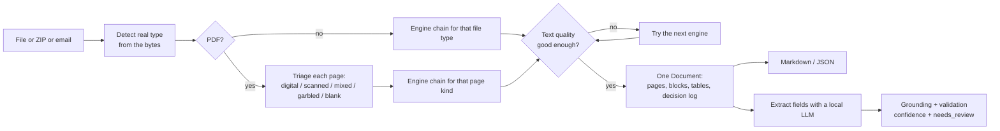

# DoctorDoc

**One door for any document: it works out what the file is, picks the best engine for each page, and returns clean Markdown/JSON plus fields you can trace back to the source text.**

> Status: early (v0.1). Parsing + router, field extraction and a web UI work. The benchmark, the
> API and the Docker image are next. Apache-2.0, fully local by default.

## 30-second quickstart

```bash
git clone <this repo> && cd doctordoc
uv venv && source .venv/bin/activate
uv pip install -e ".[ocr,docling,markitdown]"   # extras are optional: see `doctordoc engines`

doctordoc parse report.pdf --explain            # Markdown + the router's decision log
doctordoc triage report.pdf                     # what kind is each page?
doctordoc engines                               # which engines are installed, and their licenses
doctordoc ui                                    # web page: upload files, try the samples in examples/

ollama pull llama3.2:3b                         # for field extraction (local, about 2 GB)
doctordoc extract invoice.pdf --schema invoice
```

```python
from doctordoc import parse
from doctordoc.extract import extract

doc = parse("scan.pdf")
print(doc.to_markdown())
result = extract(doc, "invoice")                # or your own Pydantic model
print(result.needs_review)                      # fields a human should check
print(result.field("total").source)             # page + exact text span it came from
```

## How it works



## Web UI (`doctordoc ui`)

```bash
uv pip install -e ".[ui]"        # Streamlit
doctordoc ui                     # opens http://localhost:8501; pass --config my.yaml to change settings
```

Pure Python (Streamlit), no JavaScript build. Upload one or many files, or a ZIP; every file is
written to a temporary folder, parsed, and deleted: nothing is stored. Four tabs:

- **Parse**: detected type (and a warning if the extension lies), one chip per page (digital,
  scanned, mixed, garbled, blank) with page navigation, the page picture next to the extracted
  blocks (real tables), a tree of the files inside a ZIP or email, and the **Output** panel
  (rendered Markdown, raw Markdown, JSON, tables; copy and download; one ZIP of everything for batches).
- **Router log**: why each engine was used, rejected, skipped or failed, with quality and seconds.
- **Extract**: pick a schema (invoice, receipt, drilling report, generic form); every field with
  confidence, grounded or not, and page; click **Source** to see the exact text it came from.
- **Compare engines**: runs each installed engine alone on the same file and shows them side by
  side, with time and text-quality score, and marks the engine the router chose.

The sidebar has the OCR engine (Auto, or force one), **Local only (private)** (on by default; turning
it off allows the cloud fallback and shows a warning that pages would leave your machine), the
local Ollama model, the mixed-page merge switch and an on/off list of engines. To host a small public
demo see [docs/deploy-demo.md](docs/deploy-demo.md). The look is from
[docs/design/mockup.png](docs/design/mockup.png), a design mockup (made-up data, not a screenshot).

## Extraction output format

`doctordoc extract FILE --format json` prints this, the Extract tab downloads the same thing, and
the future API will return it. One entry per field, then the review list and the problems:

```json
{
  "schema": "Invoice",
  "model": "llama3.2:3b",
  "fields": [
    {"field": "invoice_number", "value": "RI-2025-1047", "confidence": 1.0,
     "grounded": true, "page": 1, "source_text": "RI-2025-1047"},
    {"field": "currency", "value": "USD", "confidence": 0.25,
     "grounded": false, "page": null, "source_text": null},
    {"field": "total", "value": 40000.0, "confidence": 0.95,
     "grounded": true, "page": 1, "source_text": "40,000.00"}
  ],
  "needs_review": ["currency"],
  "validation_issues": [],
  "error": null
}
```

This is a real run (shortened to three fields) on `examples/invoice_digital.pdf` with `llama3.2:3b`.
Note `currency`: the model said `USD`, but the invoice never states a currency, so it is not
grounded, its confidence is low, and it is on the review list. A validation issue looks like
`{"field": "total", "rule": "required", "message": "'total' is required but empty", "severity": "error"}`.

`field` is a path (`line_items[0].amount` for list items). `grounded: false` means the value is
not in the document text (the model made it up): `page` and `source_text` are then `null`.
`validation_issues[].severity` is `error` or `warning`. `error` is `null` unless extraction failed.

## How the router decides

1. **Detect** the real type from the bytes. A `.pdf` that is really a DOCX is handled as a DOCX, with a warning.
2. **Triage** every PDF page: *digital* (good text layer), *scanned* (no text layer), *mixed* (text plus large pictures), *garbled* (text layer exists but is nonsense), *blank*.
3. Each kind has an **engine chain**, which you can edit in `doctordoc.yaml`. The defaults:

   | Page or file kind | Chain (first engine is tried first) |
   |---|---|
   | digital PDF page | `docling` -> `pdf_text` |
   | mixed PDF page | `docling` -> `pdf_text`, plus OCR; the better result is kept and text that only the other engine found is merged in (`merge_mixed_pages`) |
   | scanned PDF page / image | `paddle_vl` -> `rapidocr` -> `tesseract` -> `cloud_vlm` |
   | garbled PDF page | OCR chain first, `pdf_text` last |
   | DOCX / PPTX | `docling` -> `native` -> `markitdown` |
   | HTML | `native` -> `docling` -> `markitdown` |
   | XLSX, CSV, JSON, XML, TXT, MD | `native` -> `markitdown` |
   | email (.eml) | `native` (attachments are parsed again as their own files) |

4. An engine's output is **accepted only if its text quality score passes** (`quality_threshold`, default 0.55). Otherwise the next engine in the chain is tried.
5. Every attempt is written to a **decision log** (`--explain`): which engine, accepted or rejected, why, the quality score, the seconds. A missing engine is skipped and logged, never a crash.
6. Only one heavy model is kept in memory at a time, and it is released after each file.
7. Cloud fallback (`cloud_vlm`) is **off by default**. If you switch it on, page images are sent to the server you configure.

## Engines and licenses

The default engines are all MIT / Apache / BSD, so you can use them commercially.

| Engine | Used for | License | Default? |
|---|---|---|---|
| native (python-docx, openpyxl, python-pptx, stdlib) | DOCX, XLSX, PPTX, CSV, JSON, HTML, email | MIT / BSD / PSF | yes |
| pdf_text (pypdfium2 / PDFium) | digital PDF text, page rendering | Apache-2.0 / BSD-3 | yes |
| [Docling](https://github.com/docling-project/docling) | digital PDF layout and tables, Office files | MIT | yes (extra `docling`) |
| [MarkItDown](https://github.com/microsoft/markitdown) | fallback for Office files | MIT | yes (extra `markitdown`) |
| [RapidOCR](https://github.com/RapidAI/RapidOCR) | scanned pages | Apache-2.0 | yes (extra `ocr`) |
| Tesseract | scanned pages, last local fallback | Apache-2.0 | yes (needs the system package) |
| PaddleOCR-VL | scanned pages (best quality, in theory) | Apache-2.0 | **experimental**, needs 8+ GB RAM or a GPU |
| cloud_vlm | optional cloud fallback you configure | depends on the service | off |
| Marker | optional plugin, **not written yet** | code GPL-3.0; model weights have revenue/funding limits for commercial use | no |
| MinerU | optional plugin, **not written yet** | custom license with conditions (check it before commercial use) | no |

PyMuPDF is **deliberately not used**: it is AGPL, which would force every user of DoctorDoc to open-source their own code.
Marker and MinerU will only ever be optional plugins that you install yourself, after reading their licenses. Check the current terms of any engine before you ship it in a product.

## Benchmarks

36 synthetic files (made-up companies, wells and numbers; fixed seed; ground truth for every file), CPU only,
every installed engine run **alone** and then the **router**. Text = 1 minus edit distance on letters and
digits; fields = `llama3.2:3b` through the same pipeline. Full tables, per-file CSV and speed:
[`benchmarks/results/RESULTS.md`](benchmarks/results/RESULTS.md).

| Document type | best single engine | router | what a single engine gets wrong |
|---|---|---|---|
| digital PDF | 1.00 (pdf_text / docling) | 1.00 | nothing: ties |
| scanned PDF (noise, blur, tilt) | 0.97 (rapidocr) | 0.97 | text-layer engines read 0.00 |
| garbled PDF (junk hidden text layer) | 1.00 (rapidocr) | 1.00 | text-layer engines read 0.25 |
| mixed PDF (text + picture of text) | **1.00 (tesseract)** | 0.98 | text-layer engines miss the picture (0.84) |
| table over two pages (cells correct) | 1.00 (docling) | 1.00 | others find no table at all (0.00) |
| docx / pptx / html / csv / xlsx | 0.99-1.00 | 0.99-1.00 | ties; engines cannot open every type |
| email with attachments, zip | n/a | 0.95 / 1.00 | single engines cannot open the attachments |
| **all 34 readable files: text** | 0.51 (docling) | **0.99** | |
| **invoice + drilling fields** | 0.68 (docling) | **0.99** | |

**How to read this honestly**

- The router's big lead over "all files" is mostly *breadth*: no single engine opens every format or page kind.
  The fair test of routing quality is the per-type rows, and there the router **ties** the best engine in most
  rows, **wins** where the page kind decides everything (garbled, scanned, tables, fields), and **loses one**:
  on mixed pages Tesseract beat the router (1.00 vs 0.98).
- Every system is given the file's real type by DoctorDoc's detector; without it the single engines would do worse.
- The set is small, synthetic and made by the same project that is being tested. It shows the router works as
  designed, not how it does on your documents. Run `python scripts/make_samples.py && python -m benchmarks.run
  [--fields]` to reproduce it, and add your own files to compare.
- Nobody reads tables from scans (0.00 for every system): OCR output has no table structure yet.
- `table_2page` text caps at 0.97 for everyone: page 2 repeats the table header, which is real text that the
  ground truth does not list.
- Speed is one run on one machine and excludes model loading. Text-layer reading is about 250 pages/s;
  Docling about 0.5 pages/s; OCR about 0.4-1.6 pages/s on CPU.

Two real router bugs were found by this benchmark and fixed: a junk text layer was being merged back on top of good
OCR text, and a picture covering under 35% of a page (e.g. a stamp) never triggered OCR (the limit is now 10%).

## Screenshots

_Coming with the Streamlit UI (`doctordoc ui`): Parse tab, Router log, Extract tab, Compare engines._

## Known limitations

Honest list, from testing on synthetic documents so far:

- **OCR has no table structure.** RapidOCR and Tesseract return one line per text block. Only Docling finds real tables, and only on digital pages. A scanned invoice table comes out as lines of text, not as a table.
- **Rotated scans are not corrected.** Triage can see that a page is rotated 90 or 270 degrees, but the page is not turned back before OCR, so a rotated scan gives poor text.
- **PaddleOCR-VL is experimental.** It is written against the library's source but is not proven here. On a machine with about 6 GB of RAM and no GPU build of PaddlePaddle, the model did not fit in memory (the process was killed after loading the weights). It is off by default on CPU. It needs 8+ GB of RAM or a GPU build of PaddlePaddle.
- **Grounding is not proof of correctness.** Every extracted value is checked against the document text, so the model cannot invent a number that is not there. But a value that is copied from the text can still sit in the wrong field (for example the due date put into "invoice date"). `needs_review` lowers that risk; it does not remove it.
- **Docling is not clearly better yet.** It is the default for digital PDFs because it finds tables, but in our tests it sometimes merges separate lines into one paragraph and splits inline bold into separate paragraphs, where the plain `pdf_text` engine did better. That is why HTML defaults to `native`. The Phase 3 benchmark will decide if "Docling first" is right for digital PDFs.
- **The "text quality" score catches junk text, not wrong text.** A scan rotated by 90 degrees is read in a scrambled order and still scores 1.00; Tesseract dropped a whole line from a clean PDF and also scored 1.00. Do not read a high score as "correct". The Compare tab exists to see this with your own eyes.
- OCR reads a phone photo mostly well but can swap look-alike characters (`RI-2025-1047` came out as `R1-2025-1047`) and mix up the order of address and table lines.
- Docling puts a PDF's title block after the body in one of our samples (the vendor name appeared at the end). Reading order is not always right.
- Excel formulas without a saved result (a file written by a script, not saved by Excel) read as empty cells.
- The UI "Copy" button opens a small box with Streamlit's own copy icon (two clicks), not a one-click button. The UI was checked in Chromium only, and not on a phone.
- Engine comparison and the page picture work for uploads and for files directly inside a ZIP or email, not for deeper nesting.
- OCR engines sometimes glue words together across wide gaps (for example `08:30-24:00Drilled`). Grounding tolerates this, but the Markdown shows it.
- Field extraction uses a small local model (`llama3.2:3b` by default) and was tested on a handful of synthetic documents. It is not benchmarked yet.
- `.msg` (Outlook) attachment reading is untested because there was no sample file.
- English OCR only for now (`ocr_languages: eng`).
- No handwriting, no formulas, and no figure understanding.

## License

Apache-2.0.
