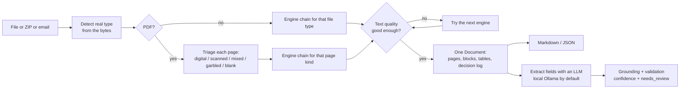
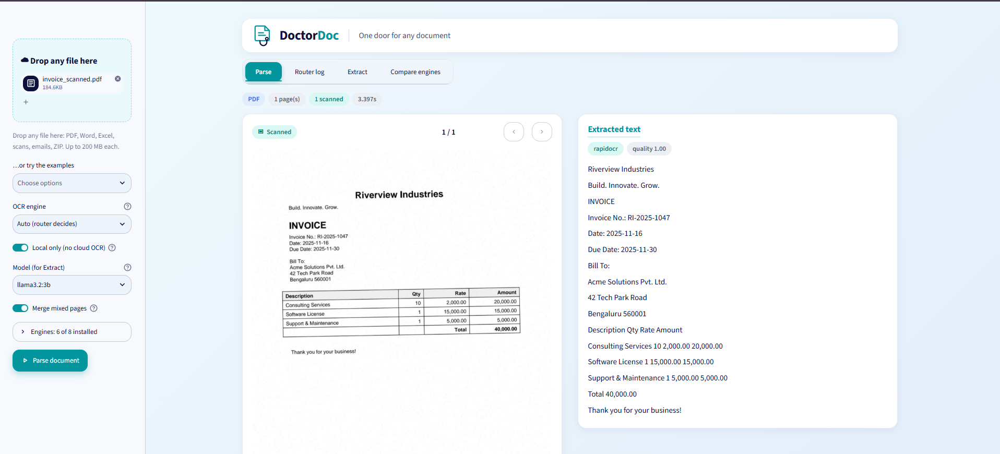
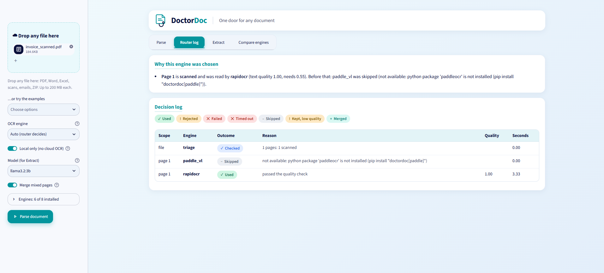
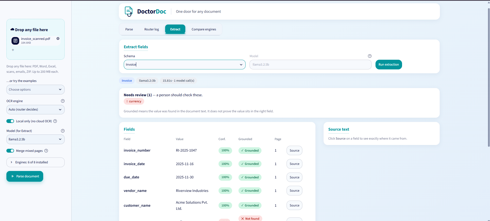
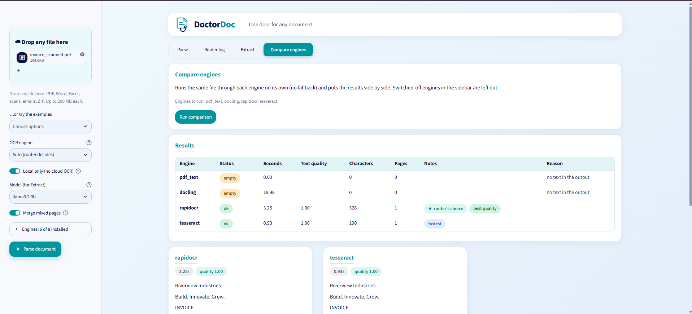

# DoctorDoc

[](https://github.com/alphindas/DoctorDoc/actions/workflows/ci.yml)

**One door for any document: it works out what the file is, picks the best engine for each page, and returns clean Markdown/JSON plus fields you can trace back to the source text.**

> Status: early (v0.1). Parsing + router, field extraction, a web UI, a local [HTTP API](#http-api) (no login) and a
> synthetic benchmark work. The Docker image is not built yet. Apache-2.0.
> A [GitHub Actions workflow](.github/workflows/ci.yml) is set up to run ruff and the tests. It does not install Docling
> or MarkItDown (the tests that need them are skipped), and it runs no benchmarks and no Ollama model. It also checks that
> an install with no extras can parse the example invoice.
>
> **Local-first:** by default, DoctorDoc runs on your computer and keeps your documents there. The
> [cloud engine](#configuration) is off by default. The Extract step sends document text to the model server in
> `llm.base_url`: by default Ollama on your computer, but you can change it.
> [ONNX Runtime telemetry](#onnx-runtime-telemetry) is turned off by default.

> **Key results and weak spots**
> - Router text **0.99**, best single engine 0.51 (34 readable files, before the rotation fix): mostly breadth. Per type it mostly ties; it loses on mixed pages ([comparison](#router-against-single-engines)).
> - Rotation fix: text on turned scans went from **0.19 to 1.00**, at about 3 times the time ([rotation](#rotated-scans-and-phone-photos)).
> - Fresh seed 5678: text **0.98**, tables **0.62**, fields **1.00** on easy fields, so a ceiling ([fresh-seed test](#1-fresh-seed-test-seed-5678)).
> - Weak: [OCR tables score 0.00](#5-ocr-tables-score-000); the quality score [accepted 37 of 41 bad outputs](#how-often-the-quality-score-is-fooled) (old pre-fix result); [photos did worse on the fresh seed](#1-fresh-seed-test-seed-5678).
> - Everything is **synthetic**: files made by this project.

## Quickstart

```bash
git clone https://github.com/alphindas/DoctorDoc.git && cd DoctorDoc
uv venv && source .venv/bin/activate
uv pip install -e ".[ocr,docling,markitdown]"   # without ocr, scanned pages and images need the Tesseract program

doctordoc parse report.pdf --explain            # Markdown + the router's decision log
doctordoc triage report.pdf                     # what kind is each page?
doctordoc engines                               # which engines are installed, and their licenses
doctordoc ui                                    # web page: upload files, try the samples in examples/

ollama pull llama3.2:3b                         # for field extraction (local model, a large download)
doctordoc extract invoice.pdf --schema invoice
```

**What `parse` prints.** Without `--out`, the result goes to standard output. Markdown there is byte for byte what
`--out` writes: UTF-8, not wrapped, nothing replaced. It is raw, so control characters in a document, terminal codes
included, reach your terminal unchanged, as with `cat`.

You can give `parse` a folder (its subfolders are read too). As Markdown, each document of a folder with several files
follows a `===== path =====` line. With `-f json`, a folder with several files, or none, prints **one JSON list** in path
order, and the `===== path =====` lines go to stderr. A folder with one file prints one object, like a single file. With
`--out FOLDER`, each output file is named after its input (`report.txt.md`). When inputs would share a name (also if
only capitals differ), their folders are put in front (`a_report.txt.md`), then a number if that is still taken, so no
result overwrites another. Each input and its output file are printed. Files already in `FOLDER`, for example from an
earlier run, are still overwritten.

```python
from doctordoc import parse
from doctordoc.extract import extract

doc = parse("scan.pdf")
print(doc.to_markdown())
result = extract(doc, "invoice")  # or your own Pydantic model
print(result.needs_review)  # fields a human should check
print(result.field("total").source)  # page + exact text span it came from
```

## Configuration

Every setting has a default. There are two ways to change one:

- **A YAML file**, passed with `--config my.yaml`. The command line does not pick up a file on its own.
  [doctordoc.example.yaml](doctordoc.example.yaml) is a starting point.
- **An environment variable:** `DOCTORDOC_` and the setting's name, with `__` between a group and a setting in it, for
  example `DOCTORDOC_MAX_FILE_MB=50` or `DOCTORDOC_LLM__MODEL=llama3.2:3b`.

**For every setting, a value in your config file wins over the environment variable.** A variable is used only for
what the file does not set. So if you copy the example file, variables for the settings it lists are ignored: remove
those lines to use the variables. Command-line options that change a setting, such as `--model` or `--no-docs`, are
applied after both.

**`page_chains`, `file_chains` and `timeouts` are merged with the defaults**, so name only the entries you want to
change, in a file or in a variable such as `DOCTORDOC_PAGE_CHAINS__DIGITAL='["pdf_text"]'`. An entry you leave out
keeps its default. To use no engines for a page kind or file type, write an empty list, for example `scanned: []`.
The default chains for scanned and garbled pages and for images end with `cloud_vlm`, which runs only if
`cloud.enabled` is true: **with cloud on, a page kind or file type you leave out can be sent to the cloud server**.

**Only keeping the cloud off protects your pages. A missing API key does not.** On the command line, in the HTTP API
and in Python, "off" means `cloud.enabled: false`, the default. **In the web UI the "Local only" switch replaces that
setting**, so "off" means leaving the switch on.

**The cloud warning.** When the config turns the cloud engine on, `parse`, `extract`, `ui` and the HTTP API log one
warning at startup. It lists the page kinds and file types whose pages the chains could send, and how to prevent it.
`ui` gives no warning if the config leaves the cloud off, although the switch can turn it on later. Using `parse()`
from Python gives no warning, and the warning does not change which engines run.

- To stop it for one entry, take `cloud_vlm` out of that chain. `[]` also works, except for `mixed` (below), but then
  no engine reads that kind of page or file, not even a local one.
- The router never gives the cloud engine a digital PDF page or a file that is not a PDF or an image: the engine
  refuses them. (Compare engines, below, is different.)
- **Mixed pages also use the `scanned` chain**, so `mixed: []` alone does not keep them off the cloud: take
  `cloud_vlm` out of the `scanned` chain too.
- **An empty `cloud.api_key` does not stop pages being sent.** The page image is sent without a key, whether or not the
  server then accepts it.
- In the web UI, pages can be sent whenever "Local only" is off, whatever `cloud.enabled` says. In tests, nothing was
  sent until `cloud_vlm` was also on in the sidebar's Engines list, or chosen as the OCR engine. **Do not rely on that
  extra step.** With `cloud_vlm` on in the list, **Compare engines** runs it on a PDF or image whatever the chains say.
  (Seen during development, no result file saved.)
- An empty `cloud.base_url` (`base_url: ""`) makes the cloud engine unavailable, also in the web UI.

### What is kept on disk

- **Parse cache off (the default):** the web UI and the HTTP API write each upload to a temporary folder and delete it.
  After a normal run, DoctorDoc keeps no copy of your documents or their text on disk. **If it is stopped or crashes
  while parsing, the temporary copy can stay there** (`kill` and `kill -9` left it behind in a test).
- **Parse cache on (`cache_dir` is set):** for each parsed file, also one inside a ZIP or email, a JSON file with its
  name and text (OCR text too) is written to that folder, and **stays until you delete it**. This applies to the web
  UI, the command line and Python, not to the HTTP API, which always turns the cache off. A relative folder starts
  from the program's working folder; the web UI shows the full path.
- **[doctordoc.example.yaml](doctordoc.example.yaml) turns the cache on** (`cache_dir: .cache/doctordoc`).
- **To turn it off,** remove `cache_dir` from your config file and unset `DOCTORDOC_CACHE_DIR`. Writing
  `cache_dir: null` in the config file also works, even with the variable set. **An empty value does not turn it
  off:** with `DOCTORDOC_CACHE_DIR=` or `cache_dir: ""`, the cache files are written into the working folder. Turning
  the cache off does not delete old files.
- **Not covered by the above:** files you ask for (`--out`, downloads), whatever a model server or cloud server keeps
  of what it receives, and files that other software writes (see [ONNX Runtime telemetry](#onnx-runtime-telemetry)).

(Seen during development with synthetic files and the native readers, `pdf_text`, RapidOCR and Tesseract, by looking
for new files in the home and temporary folders afterwards; no result file saved. Docling, MarkItDown and PaddleOCR-VL
were not checked.)

### ONNX Runtime telemetry

RapidOCR runs on ONNX Runtime. **ONNX Runtime may collect telemetry in official builds.** The `Privacy.md` file in its
package says official builds have it on by default and send it to Microsoft. **DoctorDoc turns it off by default:**
`import doctordoc`, which the command line, the web UI and the HTTP API all do, sets `ORT_DISABLE_TELEMETRY=1` unless
you have set that variable yourself.

- **To turn it back on,** set `ORT_DISABLE_TELEMETRY=0` before you start DoctorDoc. Your value is not overwritten. In
  our test, `1` and `true` turned telemetry off; `0`, `false` and an empty value left it on.
- The variable must be set before ONNX Runtime starts. **If your own program imports `onnxruntime` before `doctordoc`,
  telemetry stays on:** import `doctordoc` first, or set the variable yourself.
- It is set for the whole process and for programs that process starts, so other code there that uses ONNX Runtime is
  affected too.
- **What was verified is only that the telemetry files stop being created:** a device ID, a database that queues
  records, and a small `.ses` file in the temporary folder. **What is sent, or whether anything is sent, was not
  verified.** This is not a promise that no data leaves your machine.
- With telemetry on, the queued records described the machine; no document name or text was found in them as plain
  text. DoctorDoc does not delete files made earlier. On Linux, look in `~/.cache/Microsoft/DeveloperTools/`.

(Seen during development on Linux with ONNX Runtime 1.32.0 and RapidOCR, with networking off, no result file saved.
Windows and macOS were not tested. The same `Privacy.md` says an older Windows telemetry method ignores this variable.)

## How it works



## Web UI (`doctordoc ui`)

```bash
uv pip install -e ".[ui]"        # Streamlit
doctordoc ui                     # opens http://localhost:8501; pass --config my.yaml to change settings
```

Pure Python (Streamlit), no JavaScript build. Upload one or many files, or a ZIP; every file is
written to a temporary folder, parsed, and deleted. With the parse cache off (the default), DoctorDoc keeps no copy;
with it on, each document's text stays on disk ([what is kept](#what-is-kept-on-disk)). Four tabs:

- **Parse**: detected type (and a warning if the extension lies), one chip per page (digital,
  scanned, mixed, garbled, blank) with page navigation, the page picture next to the extracted
  blocks (real tables), a tree of the files inside a ZIP or email, and the **Output** panel
  (rendered Markdown, raw Markdown, JSON, tables; copy and download; one ZIP of everything for batches).
- **Router log**: why each engine was used, rejected, skipped or failed, with quality and seconds.
- **Extract**: pick a schema (invoice, receipt, drilling report, generic form); every field with
  confidence, grounded or not, and page; click **Source** to see the exact text it came from.
- **Compare engines**: runs each installed engine alone on the same file and shows them side by
  side, with time and text-quality score, and marks the engine the router chose.

The sidebar has the OCR engine (Auto, or force one), **Local only (no cloud OCR)** (on by default), the
model for Extract, the mixed-page merge switch and an on/off list of engines. **Pages can be sent to the cloud server
whenever "Local only" is off, even when no API key is set. Turning "Local only" on stops that: no cloud OCR.** The
switch [replaces `cloud.enabled`](#configuration). It does not control where Extract sends the document's text, which
is `llm.base_url`; the sidebar warns when that may be another computer.
To host a small public demo see [docs/deploy-demo.md](docs/deploy-demo.md). The look is from
[docs/design/mockup.png](docs/design/mockup.png), a design mockup (made-up data, not a screenshot).

## HTTP API

The API uses the same parse and extract code as the command line. It has **no login**, so it is meant for programs
on your own computer, and it works on **one heavy request at a time**. It is early: it was tested **only locally**,
with FastAPI's `TestClient`, smoke tests with `curl` against a real server, and one run of the `/docs` upload forms in
Chromium. It is **not load-tested**.

```bash
uv pip install -e ".[api]"       # add the ocr, docling and markitdown extras for more engines
doctordoc api                    # http://127.0.0.1:8000  (--host, --port, --config my.yaml, --no-docs)
```

| Endpoint | What it does |
|---|---|
| `GET /health` | status, version, and `ollama_reachable` (`null` if the server is set to an OpenAI-compatible model server) |
| `GET /engines` | every engine with its license and whether it is installed: the data of `doctordoc engines` |
| `POST /parse` | form field `file`. Query: `format=json` (default) or `markdown`; `explain=true` or `false` |
| `POST /extract` | form fields `file` and `schema`: `invoice`, `receipt`, `drilling` or `form`. Returns the [extraction report](#extraction-output-format) plus a `warnings` list |

With `format=json`, `/parse` returns the Document as JSON, which always includes each file's router decision log
(`decisions`). With `format=markdown` it returns Markdown text; add `explain=true` to get JSON with two keys,
`markdown` and `decisions`.

FastAPI's own `/docs` and `/redoc` pages (and `/openapi.json`) are on by default. Your browser loads the two pages'
scripts (and, for `/redoc`, fonts) from public servers, so they are not fully local. `--no-docs` turns all three off,
and so does `docs: false` in the settings below. The four endpoints do not need them. The upload forms on `/docs`
("Try it out") pass the [cross-site checks](#cross-site-requests): in Chromium, `/parse` and `/extract` worked at
both `127.0.0.1` and `localhost`.

### Settings

In your `--config` file (these are the defaults):

```yaml
api:
  max_waiting: 4       # /parse and /extract requests that may wait while one works
  docs: true           # serve /docs, /redoc and /openapi.json
  allowed_hosts: []    # extra Host names to accept: names only, no port
```

Environment variables work too, for example `DOCTORDOC_API__MAX_WAITING=1`, if your file does not set the same thing
([which one wins](#configuration)).

### `warnings` in `/extract`

`/extract` adds a `warnings` list to the report (empty if there is nothing to say). The command line's JSON has no such
key: it prints its warnings separately. The list can say that:

- the file extension was wrong;
- a long document was split into several model calls (added only when extraction finishes);
- a prompt may not have fitted the model's context window;
- files inside a ZIP, or email attachments, were **not read** (up to 10 names are shown);
- a file inside a ZIP or email was skipped, for example because of a size or count limit.

Other warnings from parsing are passed on too.

### Examples (real output)

The outputs below are real, from smoke tests on one machine (they are not saved in the repo). Both tests ran
**without Docling**, with `llama3.2:3b` on Ollama 0.33.1. The `/health` and `/parse` examples are from the first test;
the `/extract`, warning and refusal examples are from a second one, after the cross-site checks, waiting limit and
`warnings` were added. Run the commands from the repo folder.

```bash
curl -s http://127.0.0.1:8000/health
```

```json
{"status":"ok","version":"0.1.0","ollama_reachable":true}
```

```bash
curl -s -F file=@examples/invoice_digital.pdf "http://127.0.0.1:8000/parse?format=markdown"
```

The first lines of the reply:

```markdown
<!-- page 1 -->

# Riverview Industries

Build. Innovate. Grow.

# INVOICE

Invoice No.: RI-2025-1047 Date: 2025-11-16 Due Date: 2025-11-30
```

With `&explain=true` on the same request, `decisions` had three entries. These are the last two:

```json
[
  {"source": "invoice_digital.pdf", "scope": "page 1", "engine": "docling", "outcome": "skipped",
   "reason": "not available: python package 'docling' is not installed (pip install \"doctordoc[docling]\")",
   "quality": null, "seconds": 0.0},
  {"source": "invoice_digital.pdf", "scope": "page 1", "engine": "pdf_text", "outcome": "accepted",
   "reason": "passed the quality check", "quality": 1.0, "seconds": 0.005}
]
```

```bash
curl -s -F file=@examples/invoice_digital.pdf -F schema=invoice http://127.0.0.1:8000/extract
```

A shortened excerpt: it keeps 4 of the 20 entries in `fields`; everything else is as returned. The call took 25 s.

```json
{
  "schema": "Invoice",
  "model": "llama3.2:3b",
  "fields": [
    {"field": "invoice_number", "value": "RI-2025-1047", "confidence": 1.0,
     "grounded": true, "page": 1, "source_text": "RI-2025-1047"},
    {"field": "currency", "value": "USD", "confidence": 0.25,
     "grounded": false, "page": null, "source_text": null},
    {"field": "subtotal", "value": 40000.0, "confidence": 0.95,
     "grounded": true, "page": 1, "source_text": "40,000.00"},
    {"field": "total", "value": 40000.0, "confidence": 0.95,
     "grounded": true, "page": 1, "source_text": "40,000.00"}
  ],
  "needs_review": ["currency"],
  "validation_issues": [],
  "error": null,
  "warnings": []
}
```

The invoice shows no subtotal, yet `subtotal` is filled and **not** flagged. This differs from the
[saved command-line run](#extraction-output-format) on the same file, where Docling was installed: there `total` was
empty. **The engine that reads the file can change the extracted fields.** In the second smoke test,
`doctordoc extract --format json` in the same setup gave the same report as `/extract`, apart from the added
`warnings`. (That run used `COLUMNS=1000000`. It was made before the command line's JSON printing was fixed, when long
lines could break the JSON.)

The `warnings` from two other `/extract` requests: a copy of that PDF named `invoice.docx` (HTTP 200), and a synthetic
email with two attachments (HTTP 200):

```json
["Extension '.docx' says docx, but the content is pdf. Treating it as pdf."]
["Ignored email attachments: 2 file(s) were not read (invoice.pdf, rates.csv). The email's own text, which lists their names, was used."]
```

A request with `-H 'Origin: http://evil.example'` got HTTP 403, and one with `-H 'Host: evil.example'` got HTTP 403:

```json
{"detail":"Refused: the Origin header does not match the Host header, so the request may come from another web site."}
{"detail":"Refused: the server does not accept this Host header. Use localhost, 127.0.0.1 or ::1, or add the name to api.allowed_hosts in the server's settings."}
```

With the default limit, five `/extract` requests sent at once all got HTTP 200, finishing between 10 s and 44 s. While
they were in progress, a sixth request got HTTP 503 with the header `retry-after: 30`:

```json
{"detail":"The server is busy: 5 /parse or /extract requests are already in progress or waiting (api.max_waiting is 4). Try again later."}
```

From a second server in the first test, started with a 1 MB limit (`DOCTORDOC_MAX_FILE_MB=1`) and a model server
address with nothing on it. A 50 MB upload got HTTP 413, and an `/extract` request got HTTP 503:

```json
{"detail":"The upload is over the 1 MB limit (max_file_mb)."}
{"detail":"Cannot reach Ollama, so /extract cannot run. Start it, or check llm.base_url in the server's settings. /parse works without it."}
```

### Status codes

| Code | When |
|---|---|
| 200 | done. A file with warnings, or a ZIP with a bad file inside, is still 200: read `warnings` and each child's `error` |
| 400 | the request body is not valid form data |
| 403 | the `Host` header is not accepted, or the `Origin` header does not match it ([cross-site requests](#cross-site-requests)) |
| 413 | the upload is over `max_file_mb` |
| 415 | the file is unsupported or broken: empty, password-protected, corrupt, unknown type, or no engine could read it (also when none that could is installed, or all failed or timed out) |
| 422 | unknown schema, or a missing or wrong parameter. Also `/extract` on a readable file with no text: then the body is the extraction report, with `error` set |
| 502 | `/extract`: the model step failed (for example model not pulled, time limit, answer cut off, prompt too long). The body is the extraction report, with `error` set |
| 503 | `/parse` or `/extract`: too many requests are already waiting. This one has a `Retry-After` header |
| 503 | `/extract`: the model server cannot be reached (no `Retry-After`). `/parse` still works |
| 500 | unexpected error. The reply has no details; the server log does |

Other errors have a body with one key, `detail`.

### Safety and limits

- **No login, no HTTPS.** By default it listens on `127.0.0.1` only. `--host` with any other address prints a warning:
  anyone who can reach it can use it.
- **No CORS headers**, so a web page from another site cannot read the replies in a normal browser.
- **No stored copies.** Each upload is written to its own temporary folder, which is deleted when the request ends,
  also after an error. The parse cache (`cache_dir`) is switched off even if your settings turn it on. If the process is
  killed or the machine loses power, temporary files can be left behind. See also
  [what is kept on disk](#what-is-kept-on-disk), including files that other software writes.
- **Upload size** is capped by `max_file_mb` (default 200). The count is made while the upload arrives, and the whole
  request may be 64 KB larger to make room for the form around the file; the file itself is then checked exactly.
  The cap is on the upload, not on what it expands to: ZIP and email contents have their own limits, but a DOCX, XLSX
  or PPTX is compressed and can need far more memory than its size.
- **One heavy request at a time.** `/parse` and `/extract` share one lock, which also covers the model call, because
  only one heavy model should be in memory. If requests arrive together, one works and the **others wait**.
  `/health` and `/engines` do not wait. Run one server process: each process has its own lock and count.
  - **Only a few may wait:** `api.max_waiting`, 4 by default, so five of these requests can be in the server.
    The next gets HTTP 503 **before its upload is read or written to disk**. `Retry-After: 30` is a fixed hint, not
    an estimate of when there will be room. `max_waiting: 0` means that nothing waits.
  - A request takes its place **as soon as it arrives**, so one that is still uploading counts. The API puts no time
    limit on an upload, so a few very slow uploads can fill every place.
  - There is no time limit on the wait, and each waiting upload takes disk space. A client that disconnects while
    waiting is not meant to free its place before its turn (not tested).
  - The lock does not control Ollama, which can keep its model in memory after replying, or other programs using
    your GPU. An engine that hit its time limit can also keep running after its request ends.
  - Engine models are loaded again for each request and freed afterwards.
- **No page limit and no time limit for a whole request.** A very long file holds up everyone else. The per-page engine
  limits and the model time limit still apply. Closing the connection is not meant to stop work already running (not tested).
- **A request cannot change the server's settings**: not the model, the model server address or the engines. Cloud
  fallback is off unless the server's settings turn it on.
- **Built-in schemas only.** The command line also takes your own `module:Class`; the API refuses it, because it would
  let any caller make the server import Python code.
- **`/extract` reads only the file's own pages**, like the command line: it does not read files inside a ZIP, or the
  contents of email attachments. The API says so in `warnings`; the command line does not. An email's own text lists
  the attachment names, so the model sees the names. A plain ZIP gets 422.

### Cross-site requests

A web page you visit can make your browser send requests to a server on your own computer. Two checks refuse them with
HTTP 403, before the upload is read:

- **`Origin`:** if a request has this header, its host and port must be the same as in the `Host` header. A missing
  port means 80 for `http` and 443 for `https`; `http` and `https` themselves are not compared. `Origin: null` is
  refused. Browsers send `Origin` with a `POST` to another site. A request **without** `Origin` (`curl`, most
  scripts) is accepted.
- **`Host`:** only `localhost`, `127.0.0.1` and `::1` are accepted, with any port. This stops a web site that points
  its own name at your computer (DNS rebinding). `api.allowed_hosts` adds names to these three. You need it for any
  other name or address, including another local one such as `127.0.0.2`.
- **A non-local `--host` without `allowed_hosts` accepts any `Host`** (the server prints a warning). The `Origin` check
  stays, but a DNS rebinding page passes it, because its `Origin` and `Host` agree. Set `allowed_hosts`. A proxy in
  front of the server must pass the browser's `Host` on unchanged (not tested).

**This is not a login.** The checks only stop web browsers from being used against the server. Any other program, on
your computer or on any computer that can reach the server, can send whatever headers it likes.

## Extraction output format

`doctordoc extract FILE --format json` prints this, the Extract tab downloads the same thing, and
[`POST /extract`](#http-api) returns it with one more key, [`warnings`](#warnings-in-extract).
One entry per field, then the review list and the problems:

This is a shortened excerpt of **real output, not tuned**, from `examples/invoice_digital.pdf` with `llama3.2:3b`.
It keeps 4 of the 19 entries in `fields`; everything else is as printed. See the
[full saved output](docs/examples/extract_invoice_digital.json) and the [run details](docs/examples/README.md).

```json
{
  "schema": "Invoice",
  "model": "llama3.2:3b",
  "fields": [
    {"field": "invoice_number", "value": "RI-2025-1047", "confidence": 1.0,
     "grounded": true, "page": 1, "source_text": "RI-2025-1047"},
    {"field": "currency", "value": "USD", "confidence": 0.25,
     "grounded": false, "page": null, "source_text": null},
    {"field": "line_items[0].amount", "value": 20000.0, "confidence": 0.95,
     "grounded": true, "page": 1, "source_text": "20,000.00"},
    {"field": "subtotal", "value": 40000.0, "confidence": 0.95,
     "grounded": true, "page": 1, "source_text": "40,000.00"}
  ],
  "needs_review": ["currency", "total"],
  "validation_issues": [
    {"field": "total", "rule": "required", "message": "'total' is required but empty",
     "severity": "error"}
  ],
  "error": null
}
```

The run was not fully right:

- `total` is empty. An empty value gets no entry in `fields`, but `total` is on `needs_review` because the invoice
  schema requires it, and `validation_issues` says so.
- The invoice labels `40,000.00` as "Total" and shows no subtotal. The model put that amount in `subtotal`. It is
  grounded, has confidence 0.95 and is **not** on the review list: grounding cannot tell that a value is in the wrong field.
- `currency`: the model said `USD`, but it was not found in the document, so it is not grounded, its confidence is
  low, and it is on the review list.

This is one run on one synthetic invoice, so it shows the format, not how accurate extraction is.

`field` is a path (`line_items[0].amount` for list items). `grounded: false` means the value is
not in the document text (the model made it up): `page` and `source_text` are then `null`.
`validation_issues[].severity` is `error` or `warning`. `error` is `null` unless extraction failed.
`needs_review` can also contain `document`, which is not a field: it is there when the [length guard](#known-limitations) raised an issue.

## How the router decides

1. **Detect** the real type from the bytes. A `.pdf` that is really a DOCX is handled as a DOCX, with a warning.
2. **Triage** every PDF page: *digital* (good text layer), *scanned* (no text layer), *mixed* (text plus large pictures), *garbled* (text layer exists but is nonsense), *blank*.
3. Each kind has an **engine chain**, which you can edit in `doctordoc.yaml`. The defaults:

   | Page or file kind | Chain (first engine is tried first) |
   |---|---|
   | digital PDF page | `docling` -> `pdf_text` |
   | mixed PDF page | `docling` -> `pdf_text`, plus OCR; the better result is kept and text that only the other engine found is merged in (`merge_mixed_pages`) |
   | scanned PDF page / image | `paddle_vl` -> `rapidocr` -> `tesseract` -> `cloud_vlm` (`paddle_vl` is listed by default but skipped unless installed and able to use a GPU, or, with no GPU in use, `paddle_on_cpu: true` is set; `cloud_vlm` is skipped while cloud is off) |
   | garbled PDF page | OCR chain first, `pdf_text` last |
   | DOCX / PPTX | `docling` -> `native` -> `markitdown` |
   | HTML | `native` -> `docling` -> `markitdown` |
   | XLSX, CSV, JSON, XML, TXT, MD | `native` -> `markitdown` |
   | email (.eml) | `native` (attachments are parsed again as their own files) |

4. An engine's output is **accepted only if its text quality score passes** (`quality_threshold`, default 0.55). Otherwise the next engine in the chain is tried.
5. Every attempt is written to a **decision log** (`--explain`): which engine, accepted or rejected, why, the quality score, the seconds. A missing engine is skipped and logged, never a crash.
6. RapidOCR and Tesseract first find **which way up** a page is. A page that already reads well (score 0.75 or more,
   `rotation_early_stop`) is read once; otherwise it is read at 0, 90, 180 and 270 degrees and the best angle is kept.
7. Only one heavy model is kept in memory at a time, and it is released after each file.
8. Cloud fallback (`cloud_vlm`) is **off by default**. If you switch it on, page images can be sent to `cloud.base_url`
   (OpenAI's address unless you change it), even without an API key.

## Engines and licenses

The default engines are all MIT / Apache / BSD, so you can use them commercially.

| Engine | Used for | License | Default? |
|---|---|---|---|
| native (python-docx, openpyxl, python-pptx, stdlib) | DOCX, XLSX, PPTX, CSV, JSON, HTML, email | MIT / BSD / PSF | yes |
| pdf_text (pypdfium2 / PDFium) | digital PDF text, page rendering | Apache-2.0 / BSD-3 | yes |
| [Docling](https://github.com/docling-project/docling) | digital PDF layout and tables, Office files | MIT | yes (extra `docling`) |
| [MarkItDown](https://github.com/microsoft/markitdown) | fallback for Office files | MIT | yes (extra `markitdown`) |
| [RapidOCR](https://github.com/RapidAI/RapidOCR) | scanned pages | Apache-2.0 | yes (extra `ocr`) |
| Tesseract | scanned pages, last local fallback | Apache-2.0 | yes (needs the system package) |
| PaddleOCR-VL | scanned pages (best quality, in theory) | Apache-2.0 | **experimental**: did not fit on our CPU-only test machine (seen during development, no result file saved) |
| cloud_vlm | optional cloud fallback you configure | depends on the service | off |
| Marker | optional plugin, **not written yet** | code GPL-3.0; model weights have revenue/funding limits for commercial use | no |
| MinerU | optional plugin, **not written yet** | custom license with conditions (check it before commercial use) | no |

PyMuPDF is **deliberately not used**: it is AGPL, which would force every user of DoctorDoc to open-source their own code.
Marker and MinerU will only ever be optional plugins that you install yourself, after reading their licenses. Check the current terms of any engine before you ship it in a product.

## Benchmarks

Everything here is measured on **small sets of synthetic files made by this project**. Read the numbers as "does it
work as designed", not as accuracy on your documents.

### Router against single engines

These tables are from the full run on the first 36 files, **before** rotation correction was added.

36 synthetic files (made-up companies, wells and numbers; fixed seed; ground truth for every file), parsing and OCR on
CPU (the field model runs in Ollama and may use a GPU), every installed engine run **alone** and then the **router**.
Text = 1 minus edit distance on letters and digits; fields = `llama3.2:3b` through the same pipeline. Full tables,
per-file CSV and speed:
[`benchmarks/results/RESULTS.md`](benchmarks/results/RESULTS.md).

| Document type | best single engine | router | what a single engine gets wrong |
|---|---|---|---|
| digital PDF | 1.00 (pdf_text / docling / tesseract) | 1.00 | ties; rapidocr reads 0.97 |
| scanned PDF (noise, blur, tilt) | 0.97 (rapidocr) | 0.97 | text-layer engines read 0.00 |
| garbled PDF (junk hidden text layer) | 1.00 (rapidocr) | 1.00 | text-layer engines read 0.25-0.26 |
| mixed PDF (text + picture of text) | **1.00 (tesseract)** | 0.98 | text-layer engines miss the picture (0.84) |
| table over two pages (cells correct) | 1.00 (docling) | 1.00 | others find no table at all (0.00) |
| docx / pptx / html / csv / xlsx | 0.99-1.00 | 0.99-1.00 | ties; engines cannot open every type |
| email with attachments | 0.30 (native) | 0.95 | native alone reads 0.30 of the text and 0.00 of the table cells |
| zip | n/a | 1.00 | no single engine opens it |
| **all 34 readable files: text** | 0.51 (docling) | **0.99** | |
| **invoice + drilling fields** | 0.68 (docling) | **0.99** | |

**How to read this honestly**

- The fair test of routing quality is per type, and there the router mostly **ties** the best single engine. It ties
  on scanned PDFs (0.97), garbled PDFs (1.00), the two-page table (text 0.97, table cells 1.00) and on the fields of
  every single type. On mixed pages it **lost**: Tesseract 1.00, router 0.98.
- Its real leads are **email** (text 0.95 against 0.30), **ZIP** (no single engine opens it) and the **overall
  totals** (text 0.99 against 0.51, fields 0.99 against 0.68). The lead in the totals is mostly *breadth*: no single
  engine opens every format or page kind.
- Every system is given the file's real type by DoctorDoc's detector; without it the single engines would do worse.
- The set is small, synthetic and made by the same project that is being tested. It shows the router works as
  designed, not how it does on your documents. Compare on your own files too.
- **Today's code will not recreate these tables:** the sample generator now makes 48 files, not 36, and rotation
  correction is on. To run the current benchmark, write to new folders:

  ```bash
  python -m benchmarks.run --fields --data ~/doctordoc-rerun/data --out ~/doctordoc-rerun/results
  ```

  **Warning:** the default `--out` overwrites the saved `benchmarks/results/RESULTS.md` and `results.csv` on a full
  run. The default `--data` overwrites saved output texts in `benchmarks/data/outputs/`. Use folders that do not exist
  yet: the sample files are built only if the `--data` folder has none. With `--fields`, the run still uses and updates
  the git-ignored answer cache `benchmarks/results/llm_cache.json`.
- Nobody reads tables from scans (0.00 for every system): OCR output has no table structure yet.
- `table_2page` text averaged 0.97 for every system that read it (0.96-0.98 per file). A possible reason is that page 2
  repeats the table header and the ground truth does not list the repeat (cause not checked).
- Speed is one run on one machine and excludes model loading. In that run, `pdf_text` read about 250 pages/s over the
  files it could read, and Docling about 0.5 pages/s (about 0.3 on PDFs only). OCR ran at 0.3-1.7 pages/s on CPU,
  depending on engine and file type. In the later [seed 5678 run](benchmarks/results/runs/seed5678-router-fields/RESULTS.md),
  the router's rotated and photo files ran at 0.1 pages/s.

Since that run, the mixed-page row has changed. With RapidOCR's built-in "flip upside-down lines" step off (part of
the rotation fix), a [re-run](benchmarks/results/runs/rotation_after_regression/results.csv) of the 3 mixed files
scored 1.00 for the router, level with Tesseract. That this step was turning a good line into junk was seen during
development (no result file saved).

Two real router bugs were found by this benchmark and fixed: a junk text layer was being merged back on top of good
OCR text, and a picture covering under 35% of a page (e.g. a stamp) never triggered OCR (the limit is now 10%).

### Rotated scans and phone photos

12 more files (seed 1234): 6 scans turned 90, 180 or 270 degrees, and 6 **imitation** phone photos made by a script (tilted view,
uneven light, JPEG), 3 upright and 3 turned. They are not real photos. Router only (result files:
[before](benchmarks/results/runs/rotation_before/RESULTS.md),
[after](benchmarks/results/runs/rotation_after_earlystop/RESULTS.md)):

| files | text, no correction | text, with correction | fields, no correction | fields, with correction | seconds per page, none / always 4 reads / with early stop |
|---|---:|---:|---:|---:|---|
| turned scans (6) | 0.19 | 1.00 | 0.54 | 1.00 | 3.2 / 10.4 / 9.7 |
| turned photos (3) | 0.19 | 0.99 | 0.22 | 1.00 | 3.2 / 10.7 / 10.6 |
| upright photos (3) | 0.99 | 0.99 | 1.00 | 1.00 | 3.2 / 10.6 / **3.0** |

- **The speed cost:** a turned page takes about **3 times longer** (about 10 s instead of 3 s on CPU). An upright
  page that passes the early stop costs about what it did before. A poor but upright page that scores under 0.75 also
  pays for all four reads.
- With the early stop, the text of all 36 outputs (12 files; router, RapidOCR and Tesseract) was byte-for-byte the same
  as with four reads ([checked later from saved texts](benchmarks/results/recheck_quality_from_saved_outputs.md#byte-for-byte-check-rotation-early-stop)).
  Fields were measured on the four-read run; memos have no fields.
- **Picking the angle with the highest OCR confidence did not work** in development tests: RapidOCR and Tesseract both
  quietly straighten sideways lines and read them confidently, in the wrong order. Counting confidence only for text
  that lies horizontally did better (seen during development, no result file saved).
- **These numbers are optimistic.** The angle rule and the 0.75 cutoff were designed on pages from this same set.
  A later [fresh-seed run](#1-fresh-seed-test-seed-5678) used new files from the same generator. **Photos scored lower
  there.**

### How often the quality score is fooled

The router accepts an engine's output when its text-quality score is at least 0.55. The score never sees the true
text. Checked against the truth on **119 single-engine outputs** from 44 files (46 files were readable; no single
engine produced text for the 2 ZIPs), calling an output bad when text accuracy is under 0.90.

The accepted counts and shares are **not saved in the main results**. They were recalculated after the fact from output
texts kept locally (git-ignored), so others cannot rerun this check. Source:
[re-check](benchmarks/results/recheck_quality_from_saved_outputs.md)
([CSV](benchmarks/results/recheck_quality_from_saved_outputs.csv)), which also lists the runs in each total.

| | bad outputs | bad ones the score **accepted** | accepted outputs that were bad |
|---|---:|---:|---:|
| before the rotation fix (old result) | 41 | **37/41 (90%)** | 37/115 (32.2%) |
| after it | 23 | **19/23 (83%)** | 19/115 (16.5%) |

- Before the fix, an output that was only 0.12 accurate scored a perfect 1.00
  ([CSV](benchmarks/results/runs/rotation_before/results.csv)).
- Both before and after, it caught only **4** bad outputs. All 4 came from junk hidden text layers. It caught **4 of
  the 6** bad outputs of that kind and missed both from `garbled_3`.
- The "after" row is better because there were fewer bad outputs, **not** because the check improved.
- With a stricter bar (bad = under 0.99), it accepted 54/58 (93%) of bad outputs before the fix.
- In the saved seed 1234 runs on rotated and photo files (RapidOCR and Tesseract alone), it accepted **20 of 20** bad outputs
  [before the rotation fix](benchmarks/results/runs/rotation_before/results.csv) and **4 of 4**
  [after it](benchmarks/results/runs/rotation_after_earlystop/RESULTS.md).
- These shares depend on which files are in the set. **A high quality score does not mean the text is right.**

### Is Docling better than the simple reader on digital PDFs?

**For tables, yes. For text, no.** New digital PDFs, 5 of each type (`python -m benchmarks.digital_pdfs [--fields]`).
Each cell is simple reader (`pdf_text`) / Docling. "Lines kept" is the share of titles, labelled values and paragraphs
that stay a block of their own.

**Warning:** `benchmarks.digital_pdfs` has no `--out` option. It writes into `benchmarks/results/runs/digital_pdfs/`
and can overwrite the saved CSVs there.

| document type (files) | text | lines kept | table cells | fields | seconds per file |
|---|---|---|---|---|---|
| invoice (5) | 1.00 / 1.00 | 1.00 / 0.225 | 0.00 / 1.00 | 0.975 / 1.000 | 0.01 / 2.7 |
| drilling report (5) | 1.00 / 1.00 | 1.00 / 0.10 | 0.00 / 1.00 | 1.00 / 1.00 | under 0.01 / 2.1 |
| memo, no table (5) | 1.00 / 1.00 | 1.00 / 1.00 | - | - | under 0.01 / 1.1 |
| rate table, 2 pages (5) | 0.97 / 0.97 | - | 0.00 / 1.00 | - | 0.01 / 17.4 |
| invoice, 2 pages (5; fields on 3) | 0.98 / 0.98 | 1.00 / 0.62 | 0.00 / 1.00 | 1.00 / 1.00 | 0.01 / 11.4 |

- Docling often glues several labelled lines into one paragraph. Fields did not suffer on these files, but the
  Markdown is harder to read.
- Invoice row: Docling's 2.7 s is the average of two runs, 2.65 s
  ([first CSV](benchmarks/results/runs/digital_pdfs/invoice_ddr_memo_rates_2page_invoice_2page.csv)) and 2.85 s
  ([run with fields](benchmarks/results/runs/digital_pdfs/invoice_ddr_fields.csv)). The field scores come from the
  run with fields.
- The 0.975 against 1.000 on invoice fields is **one** field; it is too small a difference to mean anything.
- Docling stays first because the simple reader finds no tables at all. On pages without tables it adds only time.
- All of these are simple one-column pages. **Multi-column and complex layouts were not tested.**

## Benchmark findings

All files are synthetic and made by this project.

### 1. Fresh-seed test (seed 5678)

New files from the same generator: 48 files (46 good and 2 deliberately broken), router only, 13.1 min, code at commit
`a3c7653`. The result files and log do not record the commit; the author's checks before and after the run are in
[RUN_INFO.md](benchmarks/results/runs/seed5678-router-fields/RUN_INFO.md). The router and scoring code are unchanged
from `a3c7653`. A later commit added a length guard to field extraction; the seed 5678 numbers are from `a3c7653`. The
guard left the request sent to the model byte-for-byte the same for the 4 example files and the 26 seed 5678 files with
fields (checked during development, no result file saved; [a test](tests/test_prompt_guard.py) checks the example
invoice's prompt). It does change prompts when one block of text is longer than 12000 characters, and it can refuse to
send a prompt. Parsing and OCR ran with the GPU setting off; that setting does not control the Ollama model that reads
the fields. Results:
[`seed5678-router-fields`](benchmarks/results/runs/seed5678-router-fields/RESULTS.md).

| measure | result |
|---|---|
| text, 46 good files | 0.98 |
| table cells, 37 files with tables | 0.62 |
| fields, 26 files with fields | 1.00 |
| broken files that gave a clear error | 2 of 2 |
| good files wrongly rejected | 0 |
| timeouts | 0: no line of [run.log](benchmarks/results/runs/seed5678-router-fields/run.log) contains "timeout" ([RUN_INFO.md](benchmarks/results/runs/seed5678-router-fields/RUN_INFO.md)); all 46 good files finished, and no field file lost a point |

- **Weak spots in text:** photo 0.91, scanned 0.94, email 0.95. The worst single files were a turned photo (0.62), a
  heavily degraded scan (0.75) and an upright photo (0.86).
- **Photos did worse than on seed 1234:** text was 0.95 for upright and 0.87 for turned photos, against 0.99 for both
  [before](#rotated-scans-and-phone-photos). Times were also higher: upright photos 5.9 s against 3.0 s, turned photos
  14.6 s against 10.6 s, and turned scans 11.8 s against 9.7 s. These are different files; the cause was not checked.
- **Rotation:** the early-stop cutoff of 0.75 was set before this run and was not changed. The run scored 1.00 on its
  rotated files; it has no "before" run to compare with.
- **Quality score:** the three files with text under 0.90 (0.62, 0.75 and 0.86) all had a quality score of **1.00**.
- **Weak spots in tables:** 0.00 for scanned, garbled, rotated and photo files. These are the files read by OCR.
- **Small sample:** only 2 to 6 files per type (6 rotated; 6 photo; 4 each digital and scanned; 3 each garbled and
  mixed; 2 of every other type, including the 2 broken files). Fewer have tables or fields to score.
- **Field accuracy 1.00 is a ceiling:** the fields are synthetic and easy, so this score cannot show how the model
  does on harder documents. On `examples/invoice_digital.pdf`, a real run put the invoice's total under `subtotal`
  (not flagged) and left `total` empty (flagged), the same in 4 runs
  ([saved output of the first run](docs/examples/extract_invoice_digital.json)). Without Docling the same invoice gave
  `total` 40000.0 (see the [API examples](#examples-real-output)), still with `subtotal` wrongly filled (not flagged).
- This run did **not** repeat the router against single engines comparison.

### 2. Rotation fix, before and after

Turned scans (seed 1234): text **0.19 to 1.00** at about **3 times** the time ([details](#rotated-scans-and-phone-photos)). On seed 5678
the worst text score was a turned photo (0.62) and photos scored lower than before: the fix is shown on synthetic scans, but only partly on photos (cause not checked).

### 3. The quality score is weak

It can accept wrong text: **37 of 41** bad outputs in the old pre-fix result, **19 of 23** after the rotation fix
(not saved in the main results; [details and source](#how-often-the-quality-score-is-fooled)).

### 4. Docling is better only for tables

On new, simple digital PDFs it scored 1.00 on table cells against 0.00, with the same text score, but it merged lines
([details](#is-docling-better-than-the-simple-reader-on-digital-pdfs)).

### 5. OCR tables score 0.00

In every saved result CSV, each RapidOCR or Tesseract output that had a table to find scored 0.00 for table cells.
The OCR engines here return lines of text, not table structure ([limitations](#known-limitations)).

## Roadmap

Ideas that are **not built**:

- **Text from the simple reader plus tables from Docling** on digital PDFs: keep the simple reader's lines and put
  Docling's tables in their places.
- **A second check to catch wrong text**, because a passing quality score does not mean the text is right: it caught
  only 4 of 6 bad outputs from junk hidden text layers ([numbers](#how-often-the-quality-score-is-fooled)). For
  example, comparing two engines on the same page. None has been tried or measured.
- **Test field extraction on more invoice layouts.** Not built, not measured.
- A Docker image.

## Screenshots

These are real screenshots of the running UI (`doctordoc ui`, described [above](#web-ui-doctordoc-ui)), taken with
[examples/invoice_scanned.pdf](examples/invoice_scanned.pdf).



_Parse tab: `examples/invoice_scanned.pdf` is detected as scanned and shown beside the text that RapidOCR read from it._



_Router log: why RapidOCR read `examples/invoice_scanned.pdf`, and why PaddleOCR-VL was skipped (not installed)._



_Extract tab: invoice fields from `examples/invoice_scanned.pdf` with confidence, grounding and page; `currency` needs review._



_Compare engines on `examples/invoice_scanned.pdf`: both OCR engines score 1.00, yet Tesseract returned 190 characters, RapidOCR 328._

## Known limitations

Honest list, from testing on synthetic documents so far:

- **OCR has no table structure.** RapidOCR and Tesseract return one line per text block. On PDFs, Docling was the only measured engine that found real tables, and only on digital pages. (On Office, CSV, JSON and HTML files, other engines find tables too: see the [full results](benchmarks/results/RESULTS.md).) A scanned invoice table comes out as lines of text, not as a table.
- **Rotation correction has limits and a cost.** A turned page, or a poor one scoring under 0.75, is read four times: about 10 s instead of 3 s per page on CPU. `fix_rotation: false` turns it off. It handles quarter turns of left-to-right text only: no correction of other angles or of a curved or strongly tilted page, and it was designed and measured on synthetic pages, including imitations of phone photos, not real ones. PaddleOCR-VL and the cloud fallback do not use it.
- **PaddleOCR-VL is experimental.** It is written against the library's source but is not proven here. On our test machine, with no GPU build of PaddlePaddle, the model did not fit in memory: the process was killed after loading the weights (seen during development, no result file saved). It is off by default on CPU. It may need more RAM or a GPU build of PaddlePaddle.
- **Grounding is not proof of correctness.** Every extracted value is checked against the document text. A value that cannot be found there is marked `grounded: false`, gets a low confidence and, with the default settings, goes to `needs_review`. Grounding flags invented values; it does not prevent them, so the model can still return one. An invented value that happens to match text in the document is not flagged. And a value that is copied from the text can still sit in the wrong field (for example the due date put into "invoice date"). `needs_review` lowers that risk; it does not remove it.
- **Docling is first for digital PDFs only because of tables.** It reads text no better than the simple `pdf_text` engine and often merges separate lines into one paragraph ([numbers above](#is-docling-better-than-the-simple-reader-on-digital-pdfs)). It also splits inline bold into separate paragraphs, which is why HTML defaults to `native` (the splitting was seen during development, no result file saved).
- **A high "text quality" score does not mean the text is right.** In the old, pre-fix result it accepted 37 of 41 bad outputs; after the rotation fix, 19 of 23. It caught 4 of 6 bad outputs from junk hidden text layers ([details above](#how-often-the-quality-score-is-fooled)). Tesseract has also dropped a line from a clean PDF without the score showing it (seen during development, no result file saved). Do not read a high score as "correct". The Compare tab exists to see this with your own eyes.
- OCR reads a phone photo mostly well but can swap look-alike characters and mix up the order of lines (seen during development, no result file saved).
- Reading order is not always right: for example, Docling can put a PDF's title block after the body (seen during development, no result file saved).
- Excel formulas without a saved result (a file written by a script, not saved by Excel) read as empty cells (seen during development, no result file saved).
- The UI "Copy" button opens a small box with Streamlit's own copy icon (two clicks), not a one-click button (seen during development, no result file saved). The UI was checked in Chromium only (seen during development, no result file saved); other browsers and phones are not tested.
- Engine comparison and the page picture work for uploads and for files directly inside a ZIP or email, not for deeper nesting.
- **Field extraction has time and length limits.** A model reading junk text can keep writing for many minutes (seen during development, no result file saved), so by default an answer stops at 4096 tokens (`llm.max_output_tokens`), a call at 300 s (`llm.timeout`) and one document at 600 s in total (`llm.max_seconds_per_document`), with one retry. A document that hits a limit returns an error and no fields, not a partial result. Real long documents can hit them too: long item lists, or a CPU-only machine, may need higher limits (seen during development, no result file saved).
- **Long documents have a length guard, with limits.** Ollama can cut a prompt that does not fit its context window, with no error: at `llm.num_ctx` 8192, a prompt of 8116 tokens was read whole, and one of 8237 tokens was cut and reported as 4098 (seen with Ollama 0.33.1 and `llama3.2:3b` during development, no result file saved).
  - **Splitting:** text is split by characters (`llm.max_chars_per_call`, 12000), by page and then at blank lines. A single block longer than that, such as a large table, is now cut at line breaks, and a longer line by characters. Later parts of a table do not repeat its header, and a character cut can break a value in two. An ordinary piece can still be a few characters over 12000.
  - **Before sending:** the prompt's tokens are estimated from its characters. A prompt estimated above `num_ctx` minus 1024 (7168 by default) is not sent: you get an error and no fields. If only a retry is too long, it is skipped and the valid part of the earlier answer is kept.
  - **Why only 1024 is kept for the answer:** 12000 characters of this project's sample text, plus instructions, came to 5740-6771 tokens (measured during development, no result file saved). That is more than 4096, which is `num_ctx` minus the longest allowed answer (4096). So a prompt can be sent and its answer still not fit, for example with a long item list.
  - **After the reply:** Ollama's `prompt_eval_count` and `eval_count` are logged and kept in `result.llm_calls` (not in the JSON report). If the prompt count reaches the safe limit, looks like a cut (about half of `num_ctx`), or prompt plus answer is more than `num_ctx`, there is a warning, every field is marked for review, and `needs_review` also lists `document` (a `prompt_length` entry in `validation_issues` says why).
  - **Not covered:** the estimate is not the model's tokenizer. It can refuse text that would fit (for example long Chinese, Japanese or Hindi text) and can guess too low (for example Malayalam or tables full of numbers). The check after the reply is the backstop; its cut pattern was seen with this one Ollama version and model, and it needs the server to report the counts. OpenAI-compatible servers are not guarded.
- **Merging the pieces of a long document has limits.** Each piece is a separate model call, and a split document gets a warning. Every list item from every piece is kept, including repeated ones: two identical rig day-rate lines stay two. The risk is the other way: if the model lists a repeated header or total row as an item more than once, it can be counted twice. The invoice and receipt rules flag this only if a subtotal was extracted and the lines do not add up to it; the drilling and form schemas have no rule that checks for an extra item. For a single field, the first non-empty value is still kept. If a later piece gives a different non-empty value, the field goes to `needs_review` and `validation_issues` gets a `merge_conflict` error that shows both values. Its confidence is not lowered for this, and an empty later value does not count. The comparison is exact, so a small difference in spelling or capitals is flagged too. Different values for the same entry in two lists are not compared: both entries are kept. (Checked with a scripted model during development, no result file saved.)
- **Output on a terminal that is not UTF-8 is not all readable.** The command line no longer stops with
  `UnicodeEncodeError` (**fixed**): JSON and Markdown are always written as UTF-8, and the tables show `?` for each
  character the output encoding lacks. So a terminal that expects another encoding shows non-English text in JSON or
  Markdown wrongly, and a table loses it: use `-f json` or `--out` to keep the text. The HTTP API's `/extract` still
  answers HTTP 500 if the model returns half of a character pair; the command line now handles that. (Encodings were
  set by environment variables on Linux; Windows was not tested. Seen during development, no result file saved.)
- **`mixed: []` does not stop OCR on mixed pages.** For these pages the router also runs the `scanned` chain,
  including the cloud engine if that chain has it and cloud is on.
- OCR engines sometimes glue words together across wide gaps (seen during development, no result file saved). Grounding tolerates this, but the Markdown shows it.
- By default, field extraction uses a small model (`llama3.2:3b` in Ollama on your computer). It has only been measured on small synthetic sets (invoices and drilling reports).
- `.msg` (Outlook) attachment reading is not tested: this repo has no `.msg` sample file and no test for it.
- English OCR only for now (`ocr_languages: eng`).
- No handwriting, no formulas, and no figure understanding.

## Contributing and changes

[CONTRIBUTING.md](CONTRIBUTING.md) has the setup, the checks CI runs, and the project's rules on honesty, benchmarks and
licenses. [CHANGELOG.md](CHANGELOG.md) lists what has changed, including changes in behaviour.

## License

Apache-2.0.
