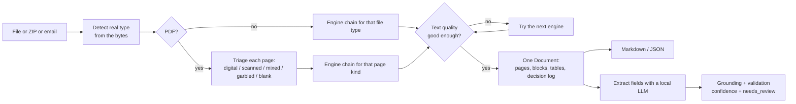

# DoctorDoc

**One door for any document: it works out what the file is, picks the best engine for each page, and returns clean Markdown/JSON plus fields you can trace back to the source text.**

> Status: early (v0.1). Parsing + router and field extraction work. The UI, the benchmark, the
> API and the Docker image are next. Apache-2.0, fully local by default.

## 30-second quickstart

```bash
git clone <this repo> && cd doctordoc
uv venv && source .venv/bin/activate
uv pip install -e ".[ocr,docling,markitdown]"   # extras are optional: see `doctordoc engines`

doctordoc parse report.pdf --explain            # Markdown + the router's decision log
doctordoc triage report.pdf                     # what kind is each page?
doctordoc engines                               # which engines are installed, and their licenses

ollama pull llama3.2:3b                         # for field extraction (local, about 2 GB)
doctordoc extract invoice.pdf --schema invoice
```

```python
from doctordoc import parse
from doctordoc.extract import extract

doc = parse("scan.pdf")
print(doc.to_markdown())
result = extract(doc, "invoice")                # or your own Pydantic model
print(result.needs_review)                      # fields a human should check
print(result.field("total").source)             # page + exact text span it came from
```

## How it works



## How the router decides

1. **Detect** the real type from the bytes. A `.pdf` that is really a DOCX is handled as a DOCX, with a warning.
2. **Triage** every PDF page: *digital* (good text layer), *scanned* (no text layer), *mixed* (text plus large pictures), *garbled* (text layer exists but is nonsense), *blank*.
3. Each kind has an **engine chain**, which you can edit in `doctordoc.yaml`. The defaults:

   | Page or file kind | Chain (first engine is tried first) |
   |---|---|
   | digital PDF page | `docling` -> `pdf_text` |
   | mixed PDF page | `docling` -> `pdf_text`, plus OCR; the better result is kept and text that only the other engine found is merged in (`merge_mixed_pages`) |
   | scanned PDF page / image | `paddle_vl` -> `rapidocr` -> `tesseract` -> `cloud_vlm` |
   | garbled PDF page | OCR chain first, `pdf_text` last |
   | DOCX / PPTX | `docling` -> `native` -> `markitdown` |
   | HTML | `native` -> `docling` -> `markitdown` |
   | XLSX, CSV, JSON, XML, TXT, MD | `native` -> `markitdown` |
   | email (.eml) | `native` (attachments are parsed again as their own files) |

4. An engine's output is **accepted only if its text quality score passes** (`quality_threshold`, default 0.55). Otherwise the next engine in the chain is tried.
5. Every attempt is written to a **decision log** (`--explain`): which engine, accepted or rejected, why, the quality score, the seconds. A missing engine is skipped and logged, never a crash.
6. Only one heavy model is kept in memory at a time, and it is released after each file.
7. Cloud fallback (`cloud_vlm`) is **off by default**. If you switch it on, page images are sent to the server you configure.

## Engines and licenses

The default engines are all MIT / Apache / BSD, so you can use them commercially.

| Engine | Used for | License | Default? |
|---|---|---|---|
| native (python-docx, openpyxl, python-pptx, stdlib) | DOCX, XLSX, PPTX, CSV, JSON, HTML, email | MIT / BSD / PSF | yes |
| pdf_text (pypdfium2 / PDFium) | digital PDF text, page rendering | Apache-2.0 / BSD-3 | yes |
| [Docling](https://github.com/docling-project/docling) | digital PDF layout and tables, Office files | MIT | yes (extra `docling`) |
| [MarkItDown](https://github.com/microsoft/markitdown) | fallback for Office files | MIT | yes (extra `markitdown`) |
| [RapidOCR](https://github.com/RapidAI/RapidOCR) | scanned pages | Apache-2.0 | yes (extra `ocr`) |
| Tesseract | scanned pages, last local fallback | Apache-2.0 | yes (needs the system package) |
| PaddleOCR-VL | scanned pages (best quality, in theory) | Apache-2.0 | **experimental**, needs 8+ GB RAM or a GPU |
| cloud_vlm | optional cloud fallback you configure | depends on the service | off |
| Marker | optional plugin, **not written yet** | code GPL-3.0; model weights have revenue/funding limits for commercial use | no |
| MinerU | optional plugin, **not written yet** | custom license with conditions (check it before commercial use) | no |

PyMuPDF is **deliberately not used**: it is AGPL, which would force every user of DoctorDoc to open-source their own code.
Marker and MinerU will only ever be optional plugins that you install yourself, after reading their licenses. Check the current terms of any engine before you ship it in a product.

## Benchmarks

_Coming in Phase 3: text accuracy, table accuracy, field accuracy and pages per second for every engine and for the router, per document type, on a fixed-seed synthetic set with ground truth._

| Document type | Engine | Text accuracy | Table accuracy | Field accuracy | Pages/sec |
|---|---|---|---|---|---|
| _to be filled by `benchmarks/run.py`_ | | | | | |

## Screenshots

_Coming with the Streamlit UI (`doctordoc ui`): Parse tab, Router log, Extract tab, Compare engines._

## Known limitations

Honest list, from testing on synthetic documents so far:

- **OCR has no table structure.** RapidOCR and Tesseract return one line per text block. Only Docling finds real tables, and only on digital pages. A scanned invoice table comes out as lines of text, not as a table.
- **Rotated scans are not corrected.** Triage can see that a page is rotated 90 or 270 degrees, but the page is not turned back before OCR, so a rotated scan gives poor text.
- **PaddleOCR-VL is experimental.** It is written against the library's source but is not proven here. On a machine with about 6 GB of RAM and no GPU build of PaddlePaddle, the model did not fit in memory (the process was killed after loading the weights). It is off by default on CPU. It needs 8+ GB of RAM or a GPU build of PaddlePaddle.
- **Grounding is not proof of correctness.** Every extracted value is checked against the document text, so the model cannot invent a number that is not there. But a value that is copied from the text can still sit in the wrong field (for example the due date put into "invoice date"). `needs_review` lowers that risk; it does not remove it.
- **Docling is not clearly better yet.** It is the default for digital PDFs because it finds tables, but in our tests it sometimes merges separate lines into one paragraph and splits inline bold into separate paragraphs, where the plain `pdf_text` engine did better. That is why HTML defaults to `native`. The Phase 3 benchmark will decide if "Docling first" is right for digital PDFs.
- OCR engines sometimes glue words together across wide gaps (for example `08:30-24:00Drilled`). Grounding tolerates this, but the Markdown shows it.
- Field extraction uses a small local model (`llama3.2:3b` by default) and was tested on a handful of synthetic documents. It is not benchmarked yet.
- `.msg` (Outlook) attachment reading is untested because there was no sample file.
- English OCR only for now (`ocr_languages: eng`).
- No handwriting, no formulas, and no figure understanding.

## License

Apache-2.0.
